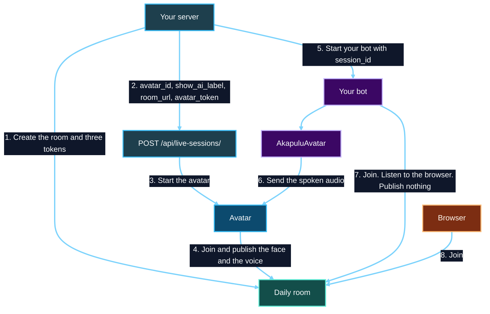

A live call is a private Daily room with three participants.

<ul>
  <li><strong style={{ color: "#EA580C" }}>Browser.</strong> The person on the call.</li>
  <li><strong style={{ color: "#7C3AED" }}>Your bot.</strong> It hears the browser and decides what to say. It does not publish a camera or a microphone.</li>
  <li><strong style={{ color: "#0284C7" }}>Avatar.</strong> It joins after you start a live session and publishes the face and the played audio.</li>
</ul>

## What you send

`POST /api/live-sessions/` takes four fields:

- `avatar_id` — which face joins
- `show_ai_label` — whether the picture shows **This is AI**
- `room_url` — the Daily room you created
- `avatar_token` — the meeting token the avatar joins with

The response is `session_id`. Your bot passes that id to `AkapuluAvatar`.

The API key stays on your server. The browser receives its own meeting token from you, not the API key.

## What the avatar publishes

The face is lip-synced to the audio your bot sends. Leave audio out and video out off on your transport. If your bot also publishes audio or video, the room has two publishers.

Every frame carries an invisible mark that reads back as `akapulu`. That mark is separate from the **This is AI** card. [Verify a recording](/guides/video-marks/verify) uploads the mp4 and reads the mark.

## Hosted link

A [hosted link](/guides/calls/hosted-links) is the same room, created for you. You set the avatar, the prompt, and the **This is AI** card. The visitor opens the URL and starts the call.

The steps for your own bot are in [Your bot](/guides/calls/your-bot).
