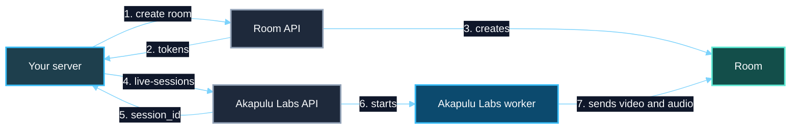
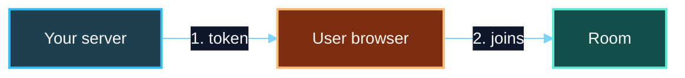
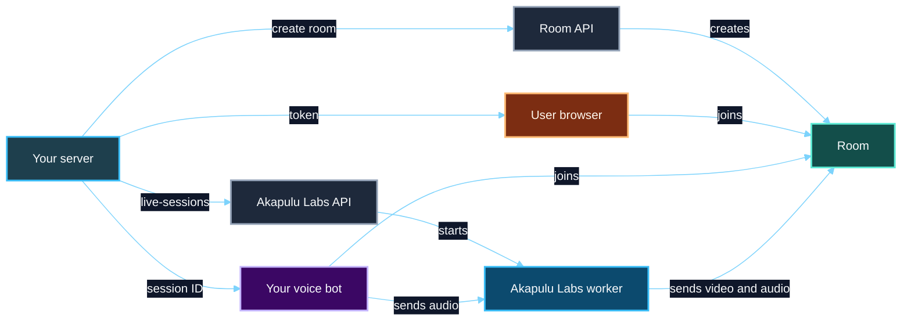
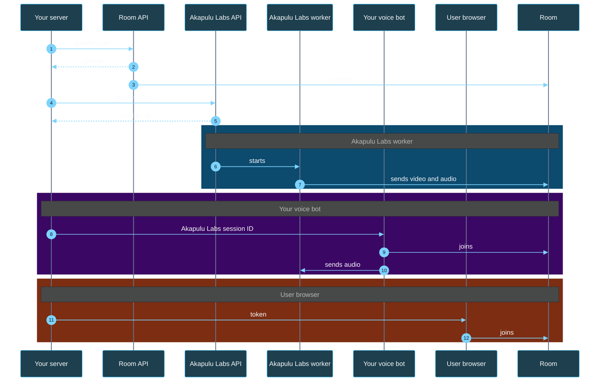

A live call is a private WebRTC room with three participants. The room is either [Daily](https://www.daily.co/) ([Pipecat](/guides/calls/pipecat)) or [LiveKit](https://livekit.io/) ([LiveKit](/guides/calls/livekit)).

<ul>
  <li><strong style={{ color: "#EA580C" }}>User browser.</strong> The person on the call.</li>
  <li><strong style={{ color: "#7C3AED" }}>Your voice bot.</strong> It hears the browser, decides what to say, and produces the assistant audio. It does not publish the face. On Pipecat that plugin is <code>AkapuluAvatar</code>. On LiveKit Agents it is <code>AvatarSession</code>. Either one sends assistant audio to the Akapulu Labs worker.</li>
  <li><strong style={{ color: "#0284C7" }}>Akapulu Labs worker.</strong> It joins after <code>POST /api/live-sessions/</code> and publishes the face and the played audio.</li>
</ul>

Your server talks to two APIs: the **room provider** (Daily or LiveKit: create the room and mint tokens) and the **Akapulu Labs API** (`POST /api/live-sessions/`, which returns `session_id` and starts the worker).

## Akapulu Labs worker joins

## Your voice bot joins

```mermaid
%%{init: {"theme":"base","themeVariables":{"darkMode":true,"background":"transparent","fontFamily":"ui-sans-serif, system-ui, sans-serif","fontSize":"14px","textColor":"#F8FAFC","primaryTextColor":"#F8FAFC","lineColor":"#7DD3FC","arrowheadColor":"#7DD3FC","edgeLabelBackground":"#0F172A"},"themeCSS":".edgeLabel, .edgeLabel p, .edgeLabel span, .labelBkg { background: #0F172A !important; color: #F8FAFC !important; } .edgePath .path, .flowchart-link { stroke: #7DD3FC !important; stroke-width: 2.5px !important; } .arrowheadPath, .marker { fill: #7DD3FC !important; stroke: #7DD3FC !important; }"}}%%
flowchart LR
  S[Your server]:::server
  V[Your voice bot]:::bot
  W[Akapulu Labs worker]:::avatar
  R[Room]:::room

  S -->|"1. Akapulu Labs session ID"| V
  V -->|"2. joins"| R
  V -->|"3. sends audio"| W
  W -->|"4. sends video and audio"| R

  classDef server fill:#1E3F4D,stroke:#38BDF8,color:#F8FAFC,stroke-width:2px
  classDef room fill:#134E4A,stroke:#5EEAD4,color:#F8FAFC,stroke-width:2px
  classDef avatar fill:#0C4A6E,stroke:#38BDF8,color:#F8FAFC,stroke-width:2px
  classDef bot fill:#3B0764,stroke:#C4B5FD,color:#F8FAFC,stroke-width:2px
```

## User browser joins

## All together

## Full sequence

## What you send

On Pipecat, `create_akapulu_call` in [`pipecat-akapulu`](https://github.com/Akapulu/pipecat-akapulu) creates the Daily room, mints the three meeting tokens, and `POST /api/live-sessions/`. On LiveKit, `create_akapulu_livekit_call` in [`livekit-akapulu`](https://github.com/Akapulu/livekit-akapulu) does the same for a LiveKit room. Both return tokens for the browser and the voice bot, plus `session_id`. A server that already has a room skips the helper and sends the live-sessions POST itself. Details: [Pipecat](/guides/calls/pipecat), [LiveKit](/guides/calls/livekit).

`POST /api/live-sessions/` always takes:

- `avatar_id`: which face joins
- `show_ai_label`: whether the picture shows **This is AI**
- `room_url`: the room endpoint (`https://` Daily URL, or LiveKit `wss://` URL)
- `avatar_token`: the token the Akapulu Labs worker joins with

For LiveKit also send `transport: "livekit"` and `room_name`. Daily is the default when `transport` is omitted. Full field rules: [Create a live session](/api-reference/live-sessions/create).

The response is `session_id`. Pass that id into `AkapuluAvatar` (Pipecat) or `AvatarSession` (LiveKit).

The Akapulu Labs API key stays on your server. The browser receives its own meeting token from you, not the API key.

## What the Akapulu Labs worker publishes

The voice bot sends assistant audio to the Akapulu Labs worker through the plugin. The worker joins as the `Avatar` participant and publishes the audio and the video. Do not publish a second face or a second copy of that audio from the voice bot. On Daily/Pipecat, unsubscribe the voice bot from the Avatar microphone when that participant joins; the browser stays subscribed. On LiveKit, keep the loading UI up until `call_is_ready` (and mute STT until then). Code: [Pipecat](/guides/calls/pipecat), [LiveKit](/guides/calls/livekit).

Every frame carries an invisible mark that reads back as `akapulu`. That mark is separate from the **This is AI** card. [Verify a recording](/guides/video-marks/verify) uploads the mp4 and reads the mark.

## Hosted link

A [hosted link](/guides/calls/hosted-links) is the same three-participant call, created for you. You set the avatar, the prompt, and the **This is AI** card. The visitor opens the URL and starts the call.

For your own voice bot: [Pipecat](/guides/calls/pipecat) or [LiveKit](/guides/calls/livekit).
