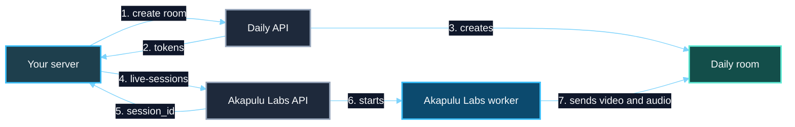
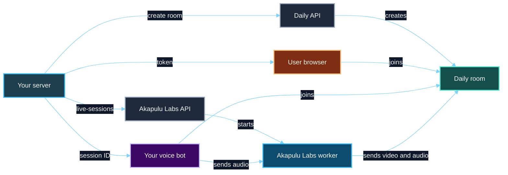
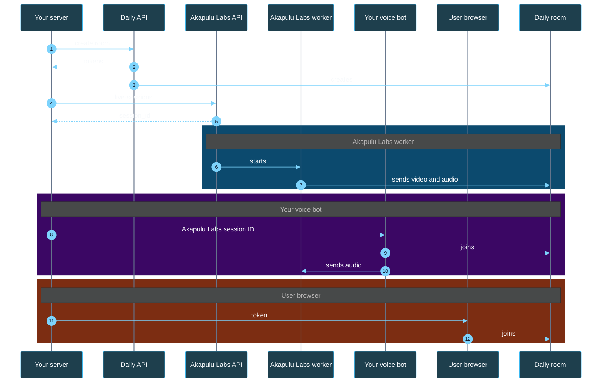

A live call is a private Daily room with three participants.

<ul>
  <li><strong style={{ color: "#EA580C" }}>User browser.</strong> The person on the call.</li>
  <li><strong style={{ color: "#7C3AED" }}>Your voice bot.</strong> It hears the browser, decides what to say, and produces the assistant audio. It does not publish a camera or a microphone back into the Daily room. <code>AkapuluAvatar</code> is the Pipecat plugin you add to that voice bot; it sends the assistant audio to the Akapulu Labs worker instead.</li>
  <li><strong style={{ color: "#0284C7" }}>Akapulu Labs worker.</strong> It joins after the Akapulu Labs API <code>POST /api/live-sessions/</code> call and publishes the face and the played audio.</li>
</ul>

Your server talks to two APIs the same way: the **Daily API** (room and meeting tokens) and the **Akapulu Labs API** (`POST /api/live-sessions/`, which returns `session_id` and starts the worker).

## Akapulu Labs worker joins

## Your voice bot joins

```mermaid
%%{init: {"theme":"base","themeVariables":{"darkMode":true,"background":"transparent","fontFamily":"ui-sans-serif, system-ui, sans-serif","fontSize":"14px","textColor":"#F8FAFC","primaryTextColor":"#F8FAFC","lineColor":"#7DD3FC","arrowheadColor":"#7DD3FC","edgeLabelBackground":"#0F172A"},"themeCSS":".edgeLabel, .edgeLabel p, .edgeLabel span, .labelBkg { background: #0F172A !important; color: #F8FAFC !important; } .edgePath .path, .flowchart-link { stroke: #7DD3FC !important; stroke-width: 2.5px !important; } .arrowheadPath, .marker { fill: #7DD3FC !important; stroke: #7DD3FC !important; }"}}%%
flowchart LR
  S[Your server]:::server
  V[Your voice bot]:::bot
  W[Akapulu Labs worker]:::avatar
  R[Daily room]:::room

  S -->|"1. Akapulu Labs session ID"| V
  V -->|"2. joins"| R
  V -->|"3. sends audio"| W
  W -->|"4. sends video and audio"| R

  classDef server fill:#1E3F4D,stroke:#38BDF8,color:#F8FAFC,stroke-width:2px
  classDef room fill:#134E4A,stroke:#5EEAD4,color:#F8FAFC,stroke-width:2px
  classDef avatar fill:#0C4A6E,stroke:#38BDF8,color:#F8FAFC,stroke-width:2px
  classDef bot fill:#3B0764,stroke:#C4B5FD,color:#F8FAFC,stroke-width:2px
```

## User browser joins

## All together

## Full sequence

## What you send

`create_akapulu_call` in [`pipecat-akapulu`](https://github.com/Akapulu/pipecat-akapulu) does this from your server: the private Daily room, the three meeting tokens, and `POST /api/live-sessions/`. It returns the room URL, the bot token, the browser token, and `session_id`. The room lasts two hours unless you pass `room_exp_secs`. The code is on [Your bot](/guides/calls/your-bot). A server that already has a Daily room skips the helper and sends this POST itself.

The Akapulu Labs API call is `POST /api/live-sessions/`. It takes four fields:

- `avatar_id`: which face joins
- `show_ai_label`: whether the picture shows **This is AI**
- `room_url`: the Daily room you created
- `avatar_token`: the meeting token the Akapulu Labs worker joins with

The response is `session_id`. Pass that id into `AkapuluAvatar`, the Pipecat plugin in your voice bot.

The Akapulu Labs API key stays on your server. The browser receives its own meeting token from you, not the API key.

## What the Akapulu Labs worker publishes

The voice bot's job is to send the assistant audio to the Akapulu Labs worker through `AkapuluAvatar`. The worker joins the call as a Daily participant and publishes the audio and the video. Leave audio out and video out off on the voice bot. If the voice bot also publishes audio or video, the room has two publishers. When the participant named `Avatar` joins, the voice bot unsubscribes from that microphone. The browser stays subscribed to it. The code is on [Your bot](/guides/calls/your-bot).

Every frame carries an invisible mark that reads back as `akapulu`. That mark is separate from the **This is AI** card. [Verify a recording](/guides/video-marks/verify) uploads the mp4 and reads the mark.

## Hosted link

A [hosted link](/guides/calls/hosted-links) is the same room, created for you. You set the avatar, the prompt, and the **This is AI** card. The visitor opens the URL and starts the call.

The steps for your own voice bot are in [Your bot](/guides/calls/your-bot).
